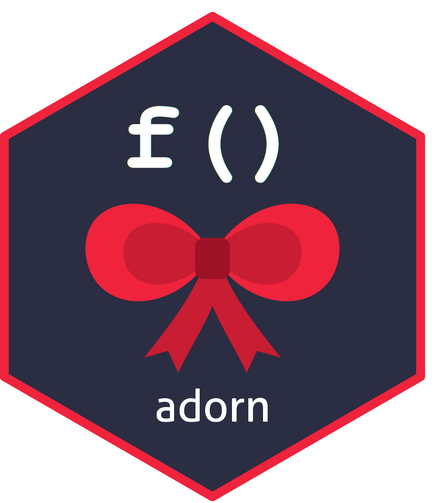

<!-- badges: start -->
[](https://github.com/DyfanJones/adorn/actions/workflows/R-CMD-check.yaml)
[](https://app.codecov.io/gh/DyfanJones/adorn)
<!-- badges: end -->

# adorn 

A framework for creating function decorators in R.

A decorator wraps a function to add behaviour such as logging, timing or
caching, without changing the function itself. adorn applies decorators with an
infix operator, `%@%`, which reads top to bottom:

```r
library(adorn)

shout <- decorator(function(f, ...) toupper(f(...)))

greet <- shout %@% function(who) paste("hello", who)
greet("world")
#> [1] "HELLO WORLD"
```

The point of adorn is that **writing your own decorator is easy**. adorn
ships no decorators of its own; it is the framework for making them.
`vignette("examples_01")` defines `timed`, `logged`, `memoize`, `once` and
`retry` with the public API. The examples below that use them assume you have
copied those definitions.

> adorn is in early development, so the API may still change.

## Installation

```r
# install.packages("pak")
pak::pak("dyfanjones/adorn")
```

## Using decorators

```r
slow_add <- timed %@% function(x, y = 1) {
  Sys.sleep(0.1)
  x + y
}
slow_add(2)
#> slow_add took 0.1 s
#> [1] 3
```

### Stacking

The decorator on the left is the outermost one.

```r
tracked <- logged %@% timed(digits = 2) %@% function(x) x * 2
tracked(21)
#> -> tracked
#> tracked took 0 s
#> <- tracked
#> [1] 42

decorators(tracked)        # "logged" "timed"
undecorate(tracked)(5)     # 10, the original function
```

### Decorator names

A decorator's name is taken from how you write it next to `%@%`: `timed %@% f`
gives `"timed"`, and `timed(digits = 2) %@% f` also gives `"timed"`. This is
the name `decorators()` reports and `decorator_context()$decorator` returns.
Pass `name` to `decorator()` to set it yourself; an explicit name is never
overwritten. A decorator that cannot be named from the expression (for example
`lst$timed`, or one applied with `decorate()`) shows as `"decorator"` unless it
was given a `name`.

Decorators can be combined into a reusable bundle before they are applied:

```r
cached_timed <- timed %@% memoize
f <- cached_timed %@% function(x) { Sys.sleep(0.1); x }
```

## Writing your own decorator

A decorator is an ordinary function whose first argument is the function being
decorated. `decorator()` turns it into a decorator. There are two styles,
chosen by whether your function has a `...` argument.

### Call style: runs on every call

```r
shout <- decorator(function(f, ...) toupper(f(...)))

greet <- shout %@% function(who, greeting = "hello") paste(greeting, who)
greet("world")
#> [1] "HELLO WORLD"
```

### Parameters

Arguments after `...` are parameters. Set them by calling the decorator.

```r
require_positive <- decorator(function(f, ..., arg = "x") {
  args <- list(...)
  if (any(args[[arg]] <= 0)) stop(arg, " must be positive", call. = FALSE)
  f(...)
})

root <- require_positive(arg = "x") %@% function(x) sqrt(x)
root(16)   # 4
root(-1)   # Error: x must be positive
```

### Factory style: keeps state

With no `...`, your function runs **once**, when the function is decorated, and
returns the replacement. Each decorated function gets its own state.

```r
counted <- decorator(function(f) {
  n <- 0
  function(...) {
    n <<- n + 1
    message(decorator_context()$name, " call #", n)
    f(...)
  }
})

ping <- counted %@% function() "pong"
ping()
#> ping call #1
```

### Example: a logging decorator

A fuller call-style decorator, using [logger](https://daroczig.github.io/logger/).
It reads the function's name from `decorator_context()`, logs the call and its
arguments, logs any error before re-throwing it, and logs how long the call took.

```r
library(adorn)
library(logger)

construct_fn <- \(.name, ...) {
  args <- list(...)
  params <- paste(paste(names(args), args, sep = "="), collapse = ",")
  sprintf("%s(%s)", .name, params)
}

logged <- decorator(
  function(f, ...) {
    name <- decorator_context()$name
    start <- Sys.time()
    log_info("===== {name} =====")
    log_info("Started {construct_fn(name, ...)} at {start}")
    tryCatch(
      output <- f(...),
      error = function(e) {
        log_error(as.character(e))
        stop(e)
      }
    )
    finished <- Sys.time()
    log_info("Finished {name} at {finished}. Elapsed={finished-start}")
    return(output)
  }
)

double <- logged %@% function(x) x * 2

double(x = 2)
#> INFO [2026-10-26 14:46:22] ===== double =====
#> INFO [2026-10-26 14:46:22] Started double(x=2) at 2026-10-26 14:46:22.91158
#> INFO [2026-10-26 14:46:22] Finished double at 2026-10-26 14:46:22.913551. Elapsed=0.00197052955627441
#> [1] 4
```

If the decorator's own code fails, the error names the decorator and the
function it was wrapping, for example `Error in logged(): object 'wrong' not
found` followed by `Decorator `logged` was wrapping `double()`.`

### Summary

| You want | Write |
|---|---|
| Code on every call | `decorator(function(f, ...) { ...; f(...) })` |
| State per decorated function | `decorator(function(f) { state <- ...; function(...) { ...; f(...) } })` |
| Options | Arguments after `...` (call style) or after `f` (factory style) |
| The function's name | `decorator_context()$name` |

## Decorating existing code: `decorate()`

`decorator()` and `%@%` cover most uses: you write a function and decorate it as
you define it. `decorate()` is for code that **already exists**. What it does
depends on the target:

| Target | Use | Why |
|---|---|---|
| A function you write | `logged %@% function(x) ...` | The usual way. |
| A function that exists, such as `stats::runif` | `decorate(fn, logged)` or `logged %@% fn` | Same result; a matter of style. |
| A method of a class (S3, S4, S7, R6) | `decorate(...)` | The method lives inside the generic or class, so there is no function to put on the right of `%@%`. `decorate()` finds it and puts the decorated version back. |

`decorate()` is an S7 generic that dispatches on the target:

| `target` | Example | Returns |
|---|---|---|
| a function | `decorate(fn, logged)` | the decorated function |
| the name of an S3 generic | `decorate("print", logged, class = "money")` | the method, replaced in place |
| an S4 generic | `decorate(area, timed, signature = "Square")` | the method, replaced in place |
| an S7 generic | `decorate(speak, timed, class = Dog)` | the method, replaced in place |
| an R6 class generator | `decorate(Counter, logged, method = "add")` | the generator, with the method replaced |

The next two examples use the `logged` decorator from the logging example above. The rest of the README uses the simpler `logged` from `vignette("examples_01")`, which prints `-> name` and `<- name`.

### A function

For a function, `decorate(fn, d)` is the same as `d %@% fn`. It returns a new
function and leaves the original alone, so this is the safe way to wrap a
function from another package. Bind it to a new name:

```r
noisy_runif <- decorate(stats::runif, logged)    # or: logged %@% runif

noisy_runif(n = 2)
#> INFO [2026-10-26 15:16:51] ===== noisy_runif =====
#> INFO [2026-10-26 15:16:51] Started noisy_runif(n=2,min=0,max=1) at 2026-10-26 15:16:51.871365
#> INFO [2026-10-26 15:16:51] Finished noisy_runif at 2026-10-26 15:16:51.873335. Elapsed=0.00197005271911621
#> [1] 0.2655087 0.3721239
```

The decorated function keeps `runif`'s arguments, and the name in the log is the
name you called it by. Pass a stack of decorators to apply several at once. The
first is outermost.

```r
slow_sq <- function(x) { Sys.sleep(0.1); x^2 }

fast_sq <- decorate(slow_sq, memoize)
fast_sq(4)   # 0.1 seconds
fast_sq(4)   # instant, from the cache
decorators(fast_sq)
#> [1] "memoize"

safe_sq <- decorate(slow_sq, retry(times = 2) %@% timed(digits = 1))
safe_sq(3)
#> safe_sq took 0.1 s
#> [1] 9
decorators(safe_sq)
#> [1] "retry" "timed"
```

### A method of a class

This is where `decorate()` is needed. Here is an S7 method that already exists:

```r
library(S7)

Dog <- new_class("Dog", properties = list(name = class_character))
speak <- new_generic("speak", "x")
method(speak, Dog) <- function(x) paste(x@name, "says woof")

speak(Dog(name = "Rex"))
#> [1] "Rex says woof"

decorate(speak, Dog) <- logged

speak(Dog(name = "Rex"))
#> INFO [2026-10-26 15:16:43] ===== method(speak, Dog) =====
#> INFO [2026-10-26 15:16:43] Started method(speak, Dog)(x=<object>) at 2026-10-26 15:16:43.178873
#> INFO [2026-10-26 15:16:43] Finished method(speak, Dog) at 2026-10-26 15:16:43.184788. Elapsed=0.00591468811035156
#> [1] "Rex says woof"
```

`decorate(speak, Dog) <- logged` is the replacement form (see below);
`decorate(speak, logged, class = Dog)` is the same thing. The method keeps its
name in the log, `method(speak, Dog)`, so you can tell which one ran.

Unlike a function, a method is replaced in place: every caller of the generic
now gets the decorated version. In a script that is usually what you want. In a
package that decorates another package's classes, do it in `.onLoad()` (not at
the top level, which runs at build time), and expect the change to be seen by
everything else in the session. For R6, decorate a subclass instead of the
other package's class: inherited methods are copied into the subclass, so the
original is untouched.

### Existing methods

```r
# S3: the generic's name, plus the class
print.money <- function(x, ...) { cat("$", x$amount, "\n"); invisible(x) }
decorate("print", logged %@% timed, class = "money")

# S4: the generic, plus the signature
decorate(area, logged, signature = "Square")

# S7: the generic, plus the class
decorate(speak, logged %@% timed, class = Dog)

# R6: the generator, plus the method name(s)
decorate(Counter, logged, method = "add")
```

Each call wraps whatever the method is now, so calling `decorate()` again adds
another layer on the outside:

```r
decorate(area, logged, signature = "Square")
decorate(area, timed, signature = "Square")

area(new("Square", side = 3))
#> -> area
#> <- area
#> area took 0 s
#> [1] 9

decorators(getMethod("area", "Square"))   # outermost first
#> [1] "timed"  "logged"
```

### Replacement form (S4, S7 and R6)

For S4, S7 and R6, where the target is an object that carries its own name, you can
also write it the way S7 writes `method(generic, class) <- fn`:

```r
decorate(speak, Dog) <- logged %@% timed     # S7: same as decorate(speak, logged %@% timed, class = Dog)
decorate(area, "Square") <- timed            # S4: same as decorate(area, timed, signature = "Square")
decorate(Counter, "add") <- logged           # R6: same as decorate(Counter, logged, method = "add")
```

For R6 the replacement form decorates public methods; use the explicit form for
`where = "private"` or `"active"`.

```r
decorate(speak, Dog) <- logged %@% timed
speak(Dog(name = "Rex"))
#> -> method(speak, Dog)
#> method(speak, Dog) took 0 s
#> <- method(speak, Dog)
#> [1] "Rex says woof"
```

Like `method<-`, assigning also rebinds the generic's name in your environment
(to the same generic). It adds a layer on top of the existing method rather than
replacing it, just like the explicit form.

S3 methods always use the explicit form: R does not allow a string as the target
of a replacement call, and a function such as `print` does not know its own
name. Trying it gives an error that says so:

```r
decorate(print, "money") <- logged
#> Error: The replacement form works for S4 and S7 generics and R6 generators. For S3 methods use
#> `decorate("generic", decorator, class = "class")`.
```

Forgetting a required argument gives a specific error:

```r
decorate("print", logged)
#> Error: Supply the S3 `class` of the method to decorate.
decorate(area, logged)
#> Error: Supply the S4 `signature` of the method to decorate.
decorate(Counter, logged)
#> Error: Supply the R6 `method` name(s) to decorate.
decorate(42, logged)
#> Error: Can't find method for `decorate(<double>)`.
```

### Teaching `decorate()` about your own class

Because `decorate()` is an S7 generic, any package can add a target type.
Here is one for a `Pipeline` that holds a list of steps:

```r
library(S7)

Pipeline <- new_class("Pipeline", properties = list(steps = class_list))

method(decorate, Pipeline) <- function(target, decorator, ...) {
  target@steps <- lapply(target@steps, decorator)
  target
}

double_it <- decorator(function(f, ...) f(...) * 2)

p <- Pipeline(steps = list(function(x) x + 1, function(x) x * 2))
p <- decorate(p, double_it)

p@steps[[1]](10)
#> [1] 22
p@steps[[2]](10)
#> [1] 40
```

## Classes: S3, S4, S7 and R6

`%@%` works wherever a function is defined: a plain function, an S3 or S4
method, an S7 method or property, an R6 method. For methods that already exist,
use `decorate()` (above).

The examples below are complete: copy and run them. Messages from `logged` and
`timed` are shown as `#>` lines.

### S3

```r
money <- function(x) structure(list(amount = x), class = "money")

print.money <- logged %@% function(x, ...) {
  cat("$", format(x$amount, nsmall = 2), "\n")
  invisible(x)
}

print(money(12.5))
#> -> print.money
#> $ 12.50
#> <- print.money
```

Decorate a method that already exists with `decorate()`:

```r
format.money <- function(x, ...) paste0("$", x$amount)
decorate("format", timed, class = "money")

format(money(3))
#> format.money took 0 s
#> [1] "$3"
```

### S4

```r
setClass("Circle", representation(r = "numeric"))
setGeneric("area", function(shape, ...) standardGeneric("area"))

setMethod("area", "Circle", logged %@% function(shape, ...) pi * shape@r^2)

area(new("Circle", r = 2))
#> -> area
#> <- area
#> [1] 12.56637
```

Decorate an existing method with `decorate()`, and ask the method for its stack:

```r
setClass("Square", representation(side = "numeric"))
setMethod("area", "Square", function(shape, ...) shape@side^2)

decorate(area, timed, signature = "Square")

area(new("Square", side = 3))
#> area took 0 s
#> [1] 9

decorators(getMethod("area", "Square"))
#> [1] "timed"
```

### S7

```r
library(S7)

Dog <- new_class("Dog", properties = list(
  name = class_character,
  shout = new_property(class_character,
    getter = logged %@% function(self) toupper(self@name))
))

speak <- new_generic("speak", "x")
method(speak, Dog) <- logged %@% function(x) paste(x@name, "says woof")

speak(Dog(name = "Rex"))
#> -> method(speak, Dog)
#> <- method(speak, Dog)
#> [1] "Rex says woof"
```

Decorate an existing method with `decorate()`:

```r
decorate(speak, timed, class = Dog)

speak(Dog(name = "Rex"))
#> -> method(speak, Dog)
#> <- method(speak, Dog)
#> method(speak, Dog) took 0.002 s
#> [1] "Rex says woof"
```

### R6

Decorated methods keep access to `self` and `private`, and `invisible(self)`
still chains.

```r
library(R6)

Counter <- R6Class("Counter",
  public = list(
    n = 0,
    add = logged %@% function(k = 1) {
      self$n <- self$n + k
      invisible(self)
    }
  )
)

counter <- Counter$new()
counter$add(2)$add(3)
#> -> add
#> <- add
#> -> add
#> <- add
counter$n
#> [1] 5
```

Decorators with state work too. Note that R6 methods belong to the class, so the
cache below is shared by every `Model` object (the key is the argument, not
`self`):

```r
Model <- R6Class("Model", public = list(
  scale = 10,
  predict = memoize %@% function(x) { Sys.sleep(0.2); x * self$scale }
))

m <- Model$new()
system.time(m$predict(2))[["elapsed"]]   # 0.2
system.time(m$predict(2))[["elapsed"]]   # 0.001, served from the cache
```

### Decorating an existing R6 class

`decorate()` takes the generator and the name of the method. Objects created
afterwards use the decorated method; objects that already exist keep the old
one, because R6 copies methods when it creates an object.

```r
Counter <- R6Class("Counter", public = list(
  n = 0,
  add = function(k = 1) {
    self$n <- self$n + k
    invisible(self)
  },
  reset = function() {
    self$n <- 0
    invisible(self)
  }
))

decorate(Counter, logged, method = "add")

counter <- Counter$new()
counter$add(2)$add(3)
#> -> add
#> <- add
#> -> add
#> <- add
counter$n
#> [1] 5
```

Pass several names to decorate them together, and `where` for private or
active methods (`"public"` is the default):

```r
decorate(Counter, timed, method = c("add", "reset"))
decorate(Safe, logged, method = "step", where = "private")
```

A method the class only *inherits* is copied into the class you pass and
decorated there. The parent is not changed, as with S7:

```r
Doubler <- R6Class("Doubler", inherit = Counter)

decorate(Doubler, logged, method = "reset")

Doubler$new()$reset()   # logged
Counter$new()$reset()   # not logged
```

### Notes

- `decorator_context()$name` reports `print.money`, `area`,
  `method(speak, Dog)` and the R6 method name.
- Active bindings and S7 property getters have no call to read a name from, so
  decorated inline they report `<anonymous>`.
- For an R6 class that already exists, use `decorate(Generator, decorator,
  method = "name")` (see above).
- If you decorate an S3 *generic*, define its methods at the top level or
  register them, as you would in a package. Methods defined only inside another
  function are not found.

## What decorating preserves

A decorated function keeps the formal arguments of the original, so argument
matching, defaults, `missing()`, lazy evaluation and `formals()` behave as
before.

## Function names

`decorator_context()$name` is the name the function was called by, taken from
the call: `fib(10)` gives `"fib"`, `obj$method(1)` gives `"method"`. Inside
stacked decorators, every layer sees the outermost name. Calls that have no
usable name, such as `lapply(x, f)`, fall back to the name of the function that
was decorated, or `"<anonymous>"`.

adorn does not define `:=`, to avoid clashing with S7, rlang and data.table.
